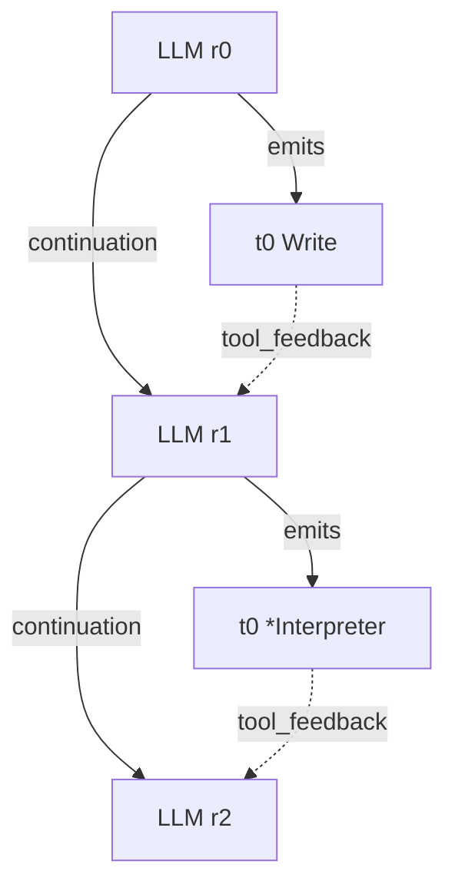
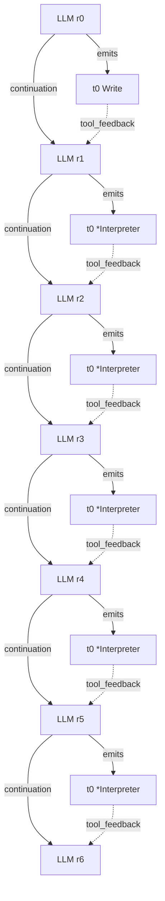
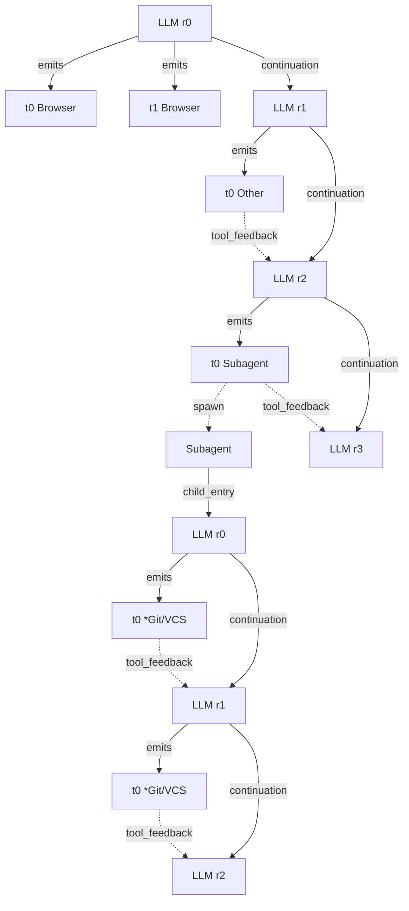

# Initial-turn DAG forecast

Validation admission on 2026-09-01, shard line 141.

At t=0 the sampler sees harness `hermes`, model `glm-5.3-flash`, and 45,725 estimated input tokens.
The initial LLM request is admitted. Its response, tool calls, and subagents are future outcomes.
Three draws with replacement use seed 42. Solid arrows show released links. Dotted arrows show inferred spawn or single-candidate feedback links.

## Sample 1

Training template 1363 has 0.670% probability per draw.
3 LLM requests, 2 tool calls, 0 matched subagent branches, and 15.760 s of observed gateway duration in the source trace.

## Sample 2

Training template 250 has 0.025% probability per draw.
12 LLM requests, 11 tool calls, 0 matched subagent branches, and 321.931 s of observed gateway duration in the source trace.

```mermaid
flowchart TD
    n0["LLM r0"]
    n1["t0 *Network"]
    n2["LLM r1"]
    n3["t0 *Interpreter"]
    n4["LLM r2"]
    n5["t0 Edit"]
    n6["LLM r3"]
    n7["t0 *Search"]
    n8["LLM r4"]
    n9["t0 *Search"]
    n10["LLM r5"]
    n11["t0 *Search"]
    n12["LLM r6"]
    n13["t0 Other"]
    n14["LLM r7"]
    n15["t0 Other"]
    n16["LLM r8"]
    n17["t0 *Wait/Poll"]
    n18["LLM r9"]
    n19["t0 *Interpreter"]
    n20["LLM r10"]
    n21["t0 Other"]
    n22["LLM r11"]
    n0 -->|emits| n1
    n0 -->|continuation| n2
    n1 -. tool_feedback .-> n2
    n2 -->|emits| n3
    n2 -->|continuation| n4
    n3 -. tool_feedback .-> n4
    n4 -->|emits| n5
    n4 -->|continuation| n6
    n5 -. tool_feedback .-> n6
    n6 -->|emits| n7
    n6 -->|continuation| n8
    n7 -. tool_feedback .-> n8
    n8 -->|emits| n9
    n8 -->|continuation| n10
    n9 -. tool_feedback .-> n10
    n10 -->|emits| n11
    n10 -->|continuation| n12
    n11 -. tool_feedback .-> n12
    n12 -->|emits| n13
    n12 -->|continuation| n14
    n13 -. tool_feedback .-> n14
    n14 -->|emits| n15
    n14 -->|continuation| n16
    n15 -. tool_feedback .-> n16
    n16 -->|emits| n17
    n16 -->|continuation| n18
    n17 -. tool_feedback .-> n18
    n18 -->|emits| n19
    n18 -->|continuation| n20
    n19 -. tool_feedback .-> n20
    n20 -->|emits| n21
    n20 -->|continuation| n22
    n21 -. tool_feedback .-> n22
```

## Sample 3

Training template 1205 has 2.797% probability per draw.
7 LLM requests, 6 tool calls, 0 matched subagent branches, and 451.876 s of observed gateway duration in the source trace.

## Validation observation

7 LLM requests, 6 tool calls, 1 matched subagent branch, and 168.889 s of observed gateway duration in the source trace.

Each eligible training root initially has equal mass globally. Each matching harness, harness/model, and harness/model/prompt group mixes uniform local mass with its parent in proportion to its size and the baseline smoothing strength. A template can receive mass from several levels.
